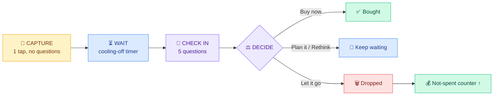
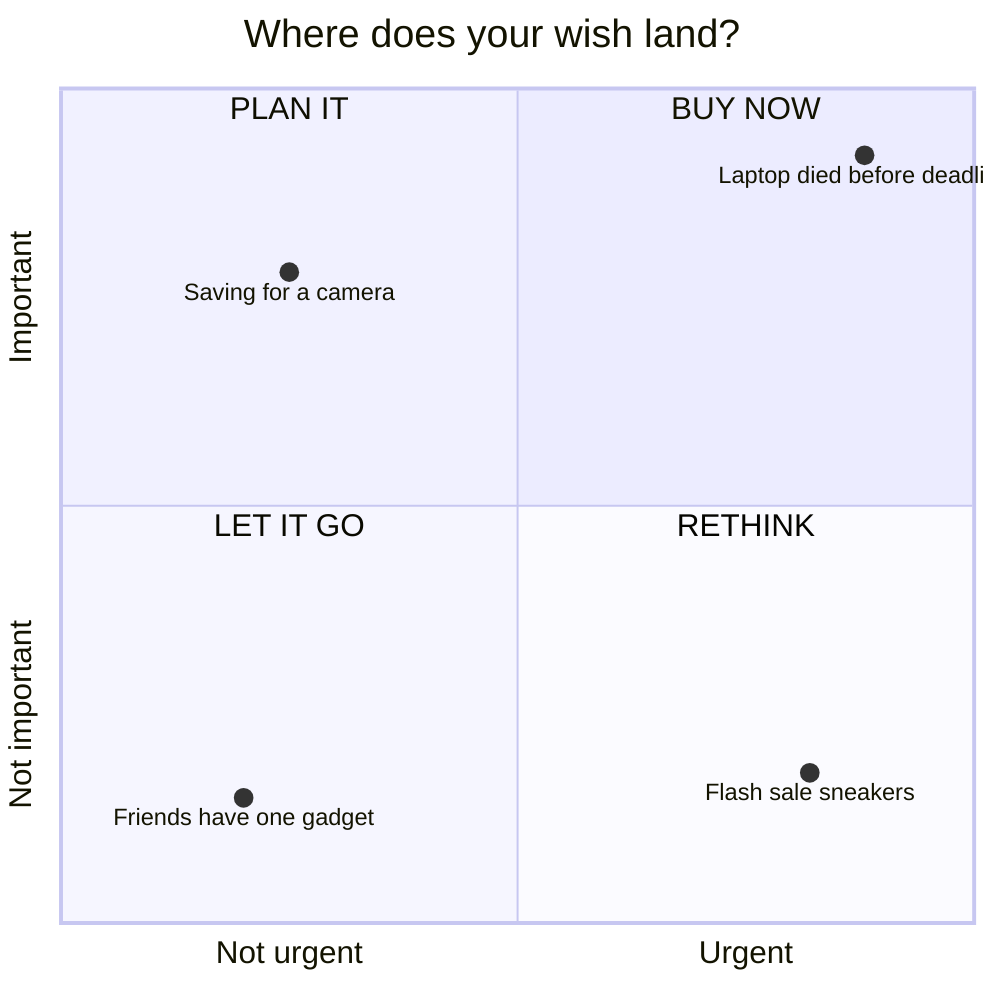

<div align="center">

```
 ┌─────────────────────────────────────────┐
 │   R E T H I N K R                       │
 │   want it?  wait.  think.  decide.      │
 └─────────────────────────────────────────┘
```

### 🪨 A wishlist that helps you want **less**.


</div>

---

## 🔥 Problem

Shop app shout **SALE**. Voucher. Bundle. PayLater. Fast delivery. Friend have one.
Brain say *buy*. Wallet cry.

| Tool | Problem |
|---|---|
| 📉 Expense tracker | Tell you **after** money gone. Too late. |
| 🛒 Marketplace wishlist | Want you **come back and buy**. Not your friend. |
| 📝 Notes app | Just a list. No wait. No think. |

**Rethinkr = on your side.**

---

## 🧠 Idea

Tempted brain no fill long form. So:

1. **Save fast.** Name + price. Under 10 seconds. No questions.
2. **Wait.** Timer run. Brain cool down.
3. **Check in.** Timer end. 5 quick questions. Calm brain answer.
4. **Decide.** App give outcome + reasons. You choose.
5. **See money not spent.** Number go up. Feel good.



---

## ⏳ Wait Time (big price = long wait)

| Price | Wait |
|---|---|
| < Rp100.000 | 🟢 **3 days** |
| Rp100.000 – 500.000 | 🟡 **7 days** |
| Rp500.000 – 2.000.000 | 🟠 **14 days** |
| > Rp2.000.000 | 🔴 **30 days** |

User can change any time. Ready items jump to top: **"Ready to review"**.

---

## 🧮 Brain of the App

Three layers. Simple.

### Layer 1 · 💳 Money gate

| Check | Result |
|---|---|
| Price > free money | ❌ **Fail** |
| Price > ~70% free money, or PayLater / credit card / installment | ⚠️ **Caution** |
| Otherwise | ✅ **Pass** |

### Layer 2 · 🗺️ Important vs Urgent

5 check-in questions. Time on list measured **by app**, no ask.

| # | Question | Feed |
|---|---|---|
| 1 | If you don't buy it, what happens? | Importance |
| 2 | Already own something similar? | Importance |
| 3 | How often will you use it? | Importance |
| 4 | When do you actually need it? *(x2 weight)* | Urgency |
| 5 | Without the discount, still buy? | Urgency |

Threshold for "high": **50 / 100** on each axis.



### Layer 3 · 🎯 Outcome

| | Urgent | Not urgent |
|---|---|---|
| **Important** | ✅ **Buy now** | 🗓️ **Plan it** *(wait until money ready)* |
| **Not important** | 🔄 **Rethink** *(borrow, rent, use what you have)* | 🪨 **Let it go** |

> Money gate **fail** → outcome drops one level.
> Buy now → Plan it. Rethink → Let it go.

---

## 🖼️ Screens

```
┌─────────┐   ┌─────────┐   ┌─────────┐   ┌─────────┐   ┌─────────┐
│ ➕ ADD  │ → │ ⏳ WAIT │ → │ 🧐 CHECK│ → │ 🎯 RESULT│ → │ 💰 SAVED│
│  item   │   │  room   │   │   in    │   │ + map   │   │ summary │
└─────────┘   └─────────┘   └─────────┘   └─────────┘   └─────────┘
```

---

## 🎒 Scope

**P0 · Must build**
- [ ] Add item (name, price, rupiah format as you type)
- [ ] Optional note + one-tap trigger chip *(function · friends have it · on sale · looks cool)*
- [ ] Waiting room with countdowns + "Ready to review"
- [ ] Check-in flow (~5 questions)
- [ ] Result screen: outcome, quadrant map, reasons, cost per use, next steps
- [ ] "Not spent" counter + bought / dropped / waiting counts
- [ ] Settings: monthly free money
- [ ] Data saved on device

**P1 · Stretch**
- [ ] Near-the-border flag
- [ ] Share card: *"I waited 14 days and did not spend Rp510.000."*
- [ ] Email reminder, screenshot/link attach, export/import
- [ ] "Still glad you bought it?" follow-up

**P2 · Roadmap**
- [ ] Read price from screenshot
- [ ] Price-drop alerts
- [ ] Push / WhatsApp reminders
- [ ] Accounts + sync

**Not doing (for now):** bank connection, expense tracking, social features, telling users what to do.

---

## 🧪 How We Check It Works

| Metric | Target |
|---|---|
| ⚡ Capture speed | Save item < 10 seconds |
| 🔁 Follow-through | Saved items reach check-in |
| 🌱 Wanting less | Share of items dropped or extended, not bought |
| 🤝 Outcome agreement | Ask 10–15 testers: result match your gut? |
| 💰 Total not spent | Sum across all testers |

After test: look at disagreements → tune weights → write down what changed.

---

## 🪞 Honest Notes

- **Result = recommendation, not verdict.** Based on self-reported answers. App show its reasons. You decide.
- **"Not spent" ≠ "saved".** It is sum of dropped items. Maybe you never would have bought. App label it that way.
- **Weights are guesses for now.** Testing will tune them.
- **Wishlists not new.** Difference is the **cooling-off + decision**, not the list.

---

<div align="center">

**Rethinkr** · Draft v0.1 · Hackathon: Finance & Lifestyle
*Want less. Keep more.* 🪨

</div>

## Getting Started

First, run the development server:

```bash
npm run dev
# or
yarn dev
# or
pnpm dev
# or
bun dev
```

Open [http://localhost:3000](http://localhost:3000) with your browser to see the result.


Check out our [Next.js deployment documentation](https://nextjs.org/docs/app/building-your-application/deploying) for more details.
