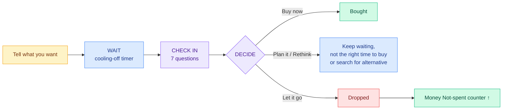
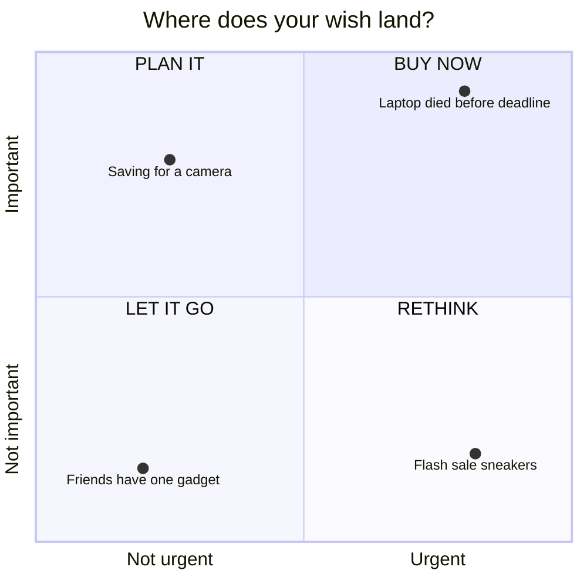

<div align="center">

### A wishlist that helps you want **less**.


</div>


## OUR TEAM — [Tambah Radit Jadi 3]

<div align="center">
  <table>
    <tr>
      <td align="center" width="200">
        <a href="https://github.com/Elfachry">
          <br />
          <sub><b>Muhammad Rusdan El Fachri</b></sub>
        </a><br />
        <sub>Frontend / Hacker</sub>
      </td>
      <td align="center" width="200">
        <a href="https://github.com/nevorium">
          <br />
          <sub><b>Faiz tok</b></sub>
        </a><br />
        <sub>Backend / Hacker</sub>
      </td>
      <td align="center" width="200">
        <a href="https://github.com/radithyaps">
          <br />
          <sub><b>Radithya Prama Syandana</b></sub>
        </a><br />
        <sub>Product Analyst / Hustler</sub>
      </td>
    </tr>
  </table>
</div>


---

## The Problem


Shop app shout **SALE**. Voucher. Bundle. PayLater. Fast delivery. Friend have one.
Brain say *buy*. Wallet cry.

| Tool | Problem |
|---|---|
| Expense tracker | Tell you **after** money gone. Too late. |
| Marketplace wishlist | Want you **come back and buy**. Not your friend. |
| Notes app | Just a list. No wait. No think. |

**Pondr = Helps you avoid impulsive buying and helps you think clearer.**

---

## Main Feature

Tempted brain no fill long form. So:

1. **Save fast.** Name + price + reason why buy. Under 15 seconds. 
2. **Wait.** Timer run. Brain cool down.
3. **Check in.** Timer end. 7 quick questions. Calm brain answer.
4. **Decide.** App give outcome + reasons. You choose.
5. **See money not spent.** Number go up. Feel good.



---

## Default Wait Time (big price = long wait, more safety)

| Price | Wait |
|---|---|
| < Rp100.000 | **3 days** |
| Rp100.000 – 500.000 | **7 days** |
| Rp500.000 – 2.000.000 | **14 days** |
| > Rp2.000.000 | **30 days** |

User can change any time. Ready items jump to top: **"Ready to review"**.

---

## Brain of the App

Three layers. Simple.

### Layer 1 · Money gate

| Check | Result |
|---|---|
| Sacrifice something or need to borrow money | Safeguard Activated |
| Less money than I'd like to | **Caution** |
| Money to Spare | **Pass** |


### Layer 2  Important vs Urgent

7 check-in questions. Time on list measured **by app**, no ask.

| # | Question | Feed |
|---|---|---|
| 1 | If you don't buy this item, what happens? | Importance (*necessity*)|
| 2 | Do you already own something that serves the same purpose? | Importance (*necessity*) |
| 3 | How often do you realistically expect to use it? | Importance (*practical value*) |
| 4 | When will you actually need this item? | Urgency |
| 5 | After waiting for this long, do you still want this item? | Desire (*do you still want it*) |
| 6 | If there were no discounts or vouchers, would you still buy it? | Desire (*even if it cost more*) |
| 7 | If you bought this item right now, would you still have enough money for your other needs? | Money gate (*financial readiness*) |


Threshold for "high": **50 / 100** on each axis.

# Eisenhower Matrix - Helps you map the importance and the urgency of your item


*note* : the quadrant only shows priority, but the real recomendation could be different if the money gate did't passed
(*example* : Buy now → Plan it, if the financial readiness gate didn't passed but overall score >= 50 ) 

### Layer 3 · Outcome

| | Urgent | Not urgent |
|---|---|---|
| **Important** | **Buy now** | **Plan it** *(wait until money ready)* |
| **Not important** | **Rethink** *(borrow, rent, use what you have)* | **Let it go** |


> Money gate **fail** → outcome drops one level.
> Buy now →  Rethink.

> But if overall score >= 50
> Buy now → Plan it.

---


## Honest Notes 

- **Result = recommendation, not verdict.** Based on self-reported answers. App show its reasons. You decide.
- **"Not spent" ≠ "saved".** It is sum of dropped items. Maybe you never would have bought. App label it that way.
- **Wishlists not new.** Difference is the **cooling-off + decision**, not the list.


## LImitations

- **Login with email magic link are currently disabled** due to supabase free tier's rate limit, so the only available login method is through google login.
- **Weights are guesses for now.** Testing will tune them.


## AI Usage
- This project uses AI for guiding the project setup, no agentic AI usage for building the main code, the humans choose what to do, which code implemented and whats not, and refined the suggested code.
- AI used for debugging and testing, helps find what bugs and suggest the fix, also tests roughly 16.000 testcases reported in simulation (not really tests it in sandbox).
- AI helps us to make better documentations especially this readme file, though we made so many changes after that, we use what AI generate as the base.

## Tech Stack

| Layer | Technology | Used for |
|---|---|---|
| **Framework** | Next.js 16.4.6 | Serves as the main framework for Routing, server-side rendering, and the login callback API. Pages are split into `(app)` and `(auth)` route groups. |
| **UI** | React 19.3.0 | Building components, including the 7-question check-in flow. |
| **Language** | TypeScript 5 | Type safety for items, check-in answers, scores, and recommendations. |
| **Styling** | Tailwind CSS 4 | Mobile-first layout with a bottom navigation bar (`BottomNav`). |
| **Icons & fonts** | lucide-react, Geist (`next/font`) | Icons and typography. |
| **Auth** | Supabase Auth | Passwordless login with Google OAuth and email OTP (magic link). Sessions are stored in cookies via `@supabase/ssr`. |
| **Database** | Supabase (PostgreSQL) | Storing each item's name, price, trigger, reason, review date, and status. |
| **Decision engine** | Rule-based TypeScript (`scoring.ts`, `recommendation.ts`, `pondr-config.ts`) | Turning the 7 answers into scores, a quadrant, and a recommendation. No AI/ML involved. |

## Starter Template
- We use Next.js basic starter template from Create Next App method

## Third Party Assets
- lucide react for icons
- Geist from next fonts for the fonts

## deployed web
https://pondr-commit.netlify.app

---

<div align="center">

**Pondr** · MVP v1.0 · Commit 2026 : Finance & Lifestyle
*Want less. Keep more.* 

</div>

## Getting Started

First, install the dependencies:
```bash
npm install
# or
yarn install
# or
pnpm install
# or
bun install
```

```bash
npm run dev
# or
yarn dev
# or
pnpm dev
# or
bun dev
```

Open [http://localhost:3000](http://localhost:3000) with your browser to see the app running.

